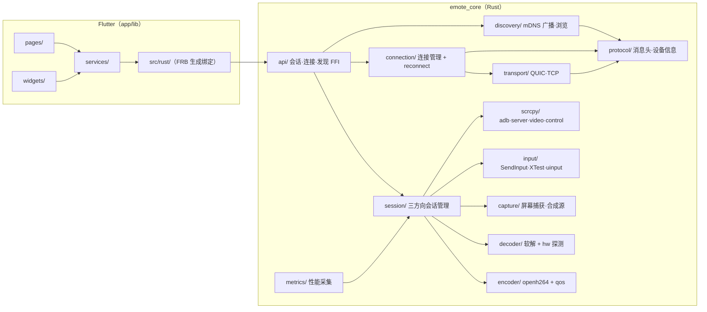

<div align="center">

# 🚀 Emote

**面向纯局域网的跨平台远程控制软件**

Windows · Linux · Android 三端互相发现、连接与控制
LAN-only · Cross-platform · Remote Control

[](https://flutter.dev)
[](https://www.rust-lang.org)
[]()
[]()
[](https://github.com/Edgerd/Emote/releases)

</div>

---

## 项目简介

Emote 是一款面向**纯局域网**的跨平台远程控制软件，端到端在同一局域网内即可完成设备的发现、连接与控制，**不依赖公网服务器、不经过第三方中转**。UI 采用 Flutter（三端共用一套界面），核心逻辑采用 Rust（经 `flutter_rust_bridge` 与 Flutter 通信），支持三方向远程控制会话、多会话并发管理、自适应码率与性能监控。

> ⚠️ 纯局域网使用，请勿跨公网部署。

## 功能特性

- **三方向远程控制会话**：`ScrcpySession`（桌面控 Android，scrcpy + ADB）、`DesktopSelfSession`（Android 控桌面，屏幕捕获 + H.264 编码上行）、`DesktopFromSession`（桌面接收对端画面并下发输入）。
- **mDNS 设备发现**：`_emote._udp.local.` / `_emote._tcp.local.` 双服务类型广播与浏览，TXT 记录携带设备 ID、名称、系统、端口与协议版本。
- **双传输层**：QUIC（quinn，默认，ALPN `emote/1`，支持 0-RTT）优先建连，失败自动回退 TCP（默认启用 `TCP_NODELAY`）。
- **软编解码**：openh264 H.264 编码/解码，`codec_available` 能力位探测，Android target 不链接编解码代码。
- **硬件解码探测与降级**（4.4）：`DecoderSelector` 探测 Media Foundation / D3D11VA / VAAPI / VDPAU / MediaCodec，不可用时自动回退 openh264 软解。
- **自适应码率**（4.5）：`QosController` 按端到端延迟动态调整码率/帧率（500 kbps～20 Mbps、5～60 fps，1 s 冷却），码率漂移自动重建编码器。
- **断线自动重连**（4.6）：指数退避（100 ms 起、×2）+ 20% 抖动 + 5 次上限，QUIC 优先 0-RTT 恢复。
- **多会话管理**（4.2）：桌面端标签容器（`IndexedStack` 保活）、移动端页面栈宿主，「更多」页入口按平台路由。
- **性能监控浮层**（4.9）：视频区域实时 FPS / 码率（滑动窗口实测）、延迟与编解码耗时展示位。
- **输入注入**：Windows `SendInput`、Linux X11 XTest / uinput，能力探测失败降级 `NullSink`，不 panic。
- **M3E 视觉**：Material Design 3 Expressive，动态颜色、自定义主题色、深色模式跟随系统。

## 架构图



## 技术栈

| 层 | 技术 |
| --- | --- |
| UI | Flutter 3.47.4（stable）、Dart 3.13.3、Material Design 3 Expressive、动态颜色（dynamic_color 1.9.0） |
| FFI | flutter_rust_bridge 2.13.0（`flutter_rust_bridge_codegen generate` 生成绑定） |
| 核心语言 | Rust 1.92.0（`rust-toolchain.toml` 锁定） |
| 传输层 | QUIC（quinn 0.11.12，默认）、TCP 回退 |
| 设备发现 | mdns-sd 0.11.5（mDNS / DNS-SD） |
| 编解码 | openh264 0.5.0（软编软解）、硬件解码探测（MF / D3D11VA / VAAPI / VDPAU / MediaCodec） |
| scrcpy 协议 | scrcpy-protocol 0.1.1（VideoPacket / ControlSender / h264） |
| 屏幕捕获 | pinray 0.2.7（`capture` feature，默认关） |
| 输入注入 | windows 0.61.3（SendInput）、x11-dl 2.21.0（XTest）、libc（uinput ioctl） |
| 异步运行时 | tokio 1.53.3（multi-thread） |

完整依赖与版本锁定见 [docs/dependencies.md](docs/dependencies.md)。

## 编译步骤

环境版本锁定见 [dependencies.md](docs/dependencies.md) 与 [rust-toolchain.toml](rust-toolchain.toml)。逐行执行以下命令（在仓库根目录）：

```sh
# 1. 安装 Rust 工具链（由 rust-toolchain.toml 自动选择 1.92.0）
rustup update stable

# 2. 安装 flutter_rust_bridge 代码生成器（版本必须为 2.13.0）
cargo install flutter_rust_bridge_codegen@2.13.0

# 3. 生成 Rust ↔ Flutter 的 FFI 绑定（产物写入 app/lib/src/rust/ 与 rust/emote_core/src/frb_generated.rs）
flutter_rust_bridge_codegen generate

# 4. 编译 Rust 核心库（cdylib / staticlib / rlib 三种产物）
cd rust/emote_core && cargo build --release && cd ../..

# 5. 进入 Flutter 应用目录并拉取依赖
cd app
flutter pub get

# 6. 构建目标平台（三选一或全部）
flutter build linux --release     # Linux（需要 GTK3 / ninja / clang）
flutter build windows --release   # Windows（需要 VS Build Tools / cmake）
flutter build apk --release       # Android（需要 NDK + cargo-ndk 4.1.2）
```

一键脚本（等价于上述流程的平台化封装）：

```sh
sh scripts/build_linux.sh
bash scripts/build_android.sh
powershell -File scripts/build_windows.ps1
```

静态检查与测试：

```sh
cd app && flutter analyze && cd ..
cd rust/emote_core && cargo test && cd ../..
```

## 运行步骤

1. 三端设备连接**同一局域网**。
2. 启动应用：Linux 执行 `build/linux/x64/release/bundle/emote`；Windows 执行 `build/windows/x64/runner/Release/emote.exe`；Android 安装 APK 并授予「本地网络 / 组播」权限。
3. 首页设备列表通过 mDNS 自动发现对端，点击设备建立连接（QUIC 优先，失败回退 TCP）。
4. 「更多 → 远程会话」启动单会话演示管线；「更多 → 多会话管理」进行多标签（桌面）/多栈（移动）并发会话管理。
5. 会话运行中，视频区域左下角显示性能浮层（FPS / 码率实测值）。

> 桌面控 Android 方向需要本机已放置 `scrcpy-server.jar`（`SCRCPY_SERVER_PATH`），否则该方向会话启动失败；其余方向离线可用合成源演示。

## 目录结构

```text
.
├── app/                    # Flutter 三端共用 UI
│   ├── lib/
│   │   ├── pages/          # 页面（设备列表 / 连接状态 / 远程会话 / 更多 / 设置 / 关于）
│   │   ├── services/       # 服务层（发现 / 连接 / 远控会话 / 设置 / 字体 / 日志）
│   │   ├── widgets/        # 组件（RemoteView / 会话标签 / 移动会话栈 / 性能浮层 / M3E 波浪进度）
│   │   ├── theme/          # M3E 主题（动态颜色 / 桌面适配 / 窗口尺寸类 / 动效）
│   │   └── src/rust/       # FRB 生成的 Dart 绑定（勿手改）
│   └── android|linux|windows/  # 各平台 Runner 与打包配置
├── rust/
│   └── emote_core/         # Rust 核心 crate
│       └── src/
│           ├── api/        # FFI 接口（simple / discovery / connection / session）
│           ├── protocol/   # 统一消息头、设备信息、QUIC/TCP 参数
│           ├── discovery/  # mDNS 广播与浏览
│           ├── transport/  # QUIC（quinn）与 TCP 双传输层
│           ├── connection/ # 连接管理器 + 断线重连策略
│           ├── session/    # 三方向会话 + 多会话管理器
│           ├── capture/    # 屏幕捕获 + 确定性合成源
│           ├── encoder/    # openh264 编码 + QoS 自适应码率
│           ├── decoder/    # 软解码 + 硬件解码探测选择器
│           ├── input/      # 输入注入（SendInput / XTest / uinput / NullSink）
│           ├── scrcpy/     # scrcpy 协议层（adb / server / video / control）
│           ├── metrics/    # 会话性能采集（FPS / 编解码耗时 / RTT）
│           └── platform/   # 跨平台抽象层（iOS/macOS 预留 stub）
├── docs/                   # 开发者文档、验收报告、限制与许可证
├── scripts/                # 三端构建脚本 + 性能快照脚本
├── .github/                # CI/CD 工作流（release.yml）与发布说明
└── flutter_rust_bridge.yaml # FRB 代码生成配置
```

## 已知限制

完整清单见 [docs/known_limitations.md](docs/known_limitations.md)。要点：

- scrcpy-server.jar 未自动分发，桌面控 Android 方向需手动放置 jar。
- QUIC 证书校验为局域网信任模型（跳过对端校验）；严格校验代码已就绪，待 `cert=` 指纹经 mDNS TXT 发布后启用。
- Linux Wayland 下 XTest 输入注入不可用（需 X11 会话）；硬件解码真实后端待真机联调，当前一律软解兜底。
- 性能浮层中延迟与编解码耗时的 FFI metrics 接口尚未经 FRB 生成，暂显示 0 占位。
- macOS / iOS 未实现，`platform/` 仅保留抽象 stub。

## 许可证

本项目基于 **Apache-2.0** 开源协议发布（见根目录 [LICENSE](LICENSE)）。第三方依赖许可证汇总见 [docs/licenses.md](docs/licenses.md)，全部与 Apache-2.0 兼容。

> 第三方依赖 `openh264`（crate，BSD-2-Clause）封装的 Cisco OpenH264 编解码器：官方规定分发其**预编译二进制**需另行申请免费商用许可（见 openh264 仓库 License 说明）；从源码自行构建则无需申请。

---

## 📦 发行版

- **Dev-4.0**（预览版）：硬件解码探测、自适应码率、断线重连、多会话管理 UI、性能浮层。
- **Dev-3.0**（预览版）：三方向远程控制会话、scrcpy 协议层、桌面 openh264 软编解码。
- **v2.3.1 / v2.3.1-hotfix**（预览版）：MD3E「更多」页、M3E 波浪进度条、开发者选项（hotfix 为 Android 构建修复）。
- **v2.2.1**（首个正式版）：mDNS TXT 解析修复、自发现过滤、字体下载流式写盘。
- **Dev-2.1 / Dev-2.0**（预览版）：Rust 核心与 FFI 桥接、mDNS 发现框架、双传输层。
- **v1.0.0**（预览版）：首个公开预览，工程骨架与基础连通性。

每个 Release 均附带 Windows（zip）、Linux（tar.gz / AppImage）与 Android（apk）三端产物。完整发布说明见各 [Release](https://github.com/Edgerd/Emote/releases) 详情（`.github/release-notes/`）。

## 🤝 贡献

欢迎任何形式的贡献：

1. Fork 本仓库并创建功能分支
2. 提交清晰的改动
3. 打开 Pull Request
4. 等待 Review 与合并

如有功能建议或 Bug，请提 [Issue](https://github.com/Edgerd/Emote/issues)。
