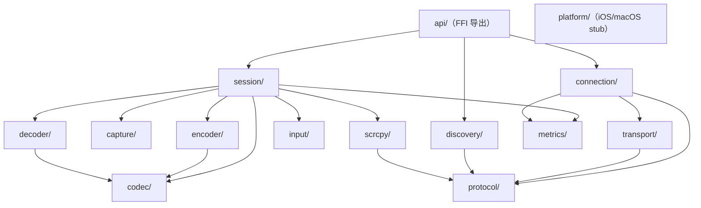

# Rust 模块依赖图

> 与代码同步基线：`emote_core` 0.1.0（Dev-5.0）。模块声明见 `rust/emote_core/src/lib.rs`。

## 模块依赖（Mermaid）



调用方向：上层（`api/`）依赖下层能力模块；`protocol/` 与 `metrics/` 为被依赖的横切模块，不反向依赖任何业务模块。

## 模块职责与 Flutter 侧对应文件

| Rust 模块 | 职责 | Flutter 侧对应文件 |
| --- | --- | --- |
| `api/simple` | FRB 最小演示接口 `greet` | `app/lib/src/rust/api/simple.dart`（生成） |
| `api/discovery` | 设备发现 FFI 句柄 `DiscoveryHandle` | `app/lib/services/discovery_service.dart` |
| `api/connection` | 连接管理 FFI 句柄 `ConnectionHandle` | `app/lib/services/connection_service.dart` |
| `api/session` | 远控会话 FFI 句柄 `SessionHandle` | `app/lib/services/remote_session_service.dart` |
| `protocol/` | 统一消息头（`EMOT` 魔数 10B）、心跳规则、`DeviceInfo`/状态枚举、QUIC/TCP 参数 | 绑定类型分布在 `app/lib/src/rust/`（生成）；常量镜像于 `discovery_service.dart` 端口常量 |
| `discovery/` | mDNS 广播（`service.rs`）与浏览（`Browser`）+ 共享状态缓存 | `app/lib/services/discovery_service.dart` |
| `transport/` | QUIC（quinn，0-RTT）与 TCP（NODELAY）双传输层 | 无直接对应（经 `ConnectionHandle` 间接使用） |
| `connection/` | 多设备连接表（`manager.rs`）+ 指数退避重连（`reconnect.rs`） | `app/lib/services/connection_service.dart`（状态轮询） |
| `session/` | 三方向会话（`sessions.rs`）+ `SessionManager` 多会话并发管理 | `app/lib/pages/remote_session_page.dart`、`app/lib/widgets/session_tabs.dart`、`app/lib/widgets/mobile_session_stack.dart` |
| `capture/` | 真机屏幕捕获（pinray，feature 开关）+ 确定性合成源 `SyntheticSource` | 无直接对应 |
| `encoder/` | openh264 H.264 编码 + QoS 自适应码率（`qos.rs`） | 无直接对应（经 `SessionHandle.setBitrate`） |
| `decoder/` | openh264 软解 + 硬件解码探测选择器（`hw.rs`） | `app/lib/services/remote_session_service.dart`（能力展示） |
| `input/` | 输入注入：`windows.rs`（SendInput）、`linux.rs`（XTest）、`uinput.rs`、`NullSink` 降级 | `app/lib/pages/remote_session_page.dart`（输入按钮） |
| `scrcpy/` | `adb.rs`（连接/推流/启动）、`server.rs`、`video.rs`（帧解析）、`control.rs` | 无直接对应（经 `SessionHandle` Scrcpy 方向） |
| `codec/` | H.264 帧类型与码流工具（`H264FrameType`） | 无直接对应 |
| `metrics/` | 会话级性能采集（FPS/编解码耗时/RTT/FFI 耗时） | `app/lib/widgets/metrics_overlay.dart`（FPS/码率本地实测） |
| `platform/` | iOS/macOS 预留抽象 stub | 无 |
| `frb_generated.rs` | FRB 自动生成桥接入口（勿手改） | `app/lib/src/rust/frb_generated.dart`（生成） |

## Flutter 侧结构（对照）

```text
app/lib/
├── pages/     device_list / connection_status / remote_session / more / settings / about / developer_options / log_viewer
├── services/  discovery_service / connection_service / remote_session_service / settings_controller
│              dev_settings_controller / android_connectivity / harmony_font_loader / app_log
├── widgets/   remote_view / session_tabs / mobile_session_stack / metrics_overlay
│              connection_overlay / m3e_wave_progress
└── theme/     app_theme / dynamic_color / desktop_adaptation / window_size_class / motion
```
